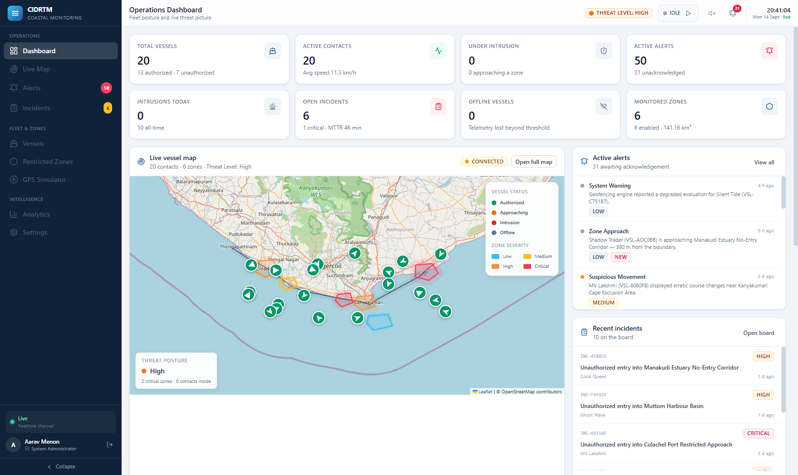
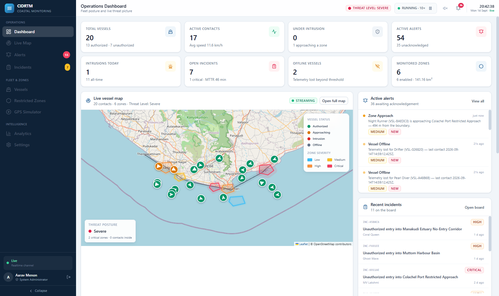
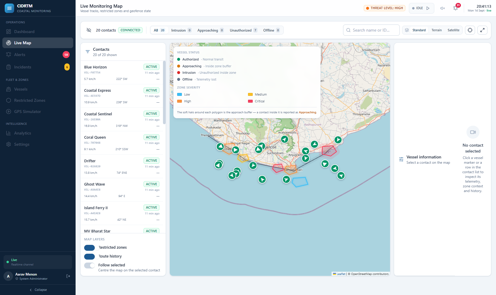
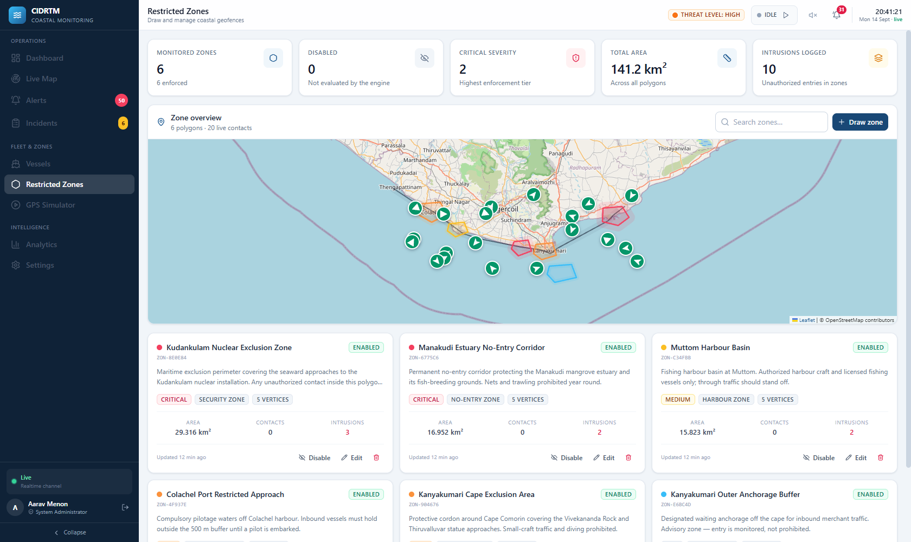
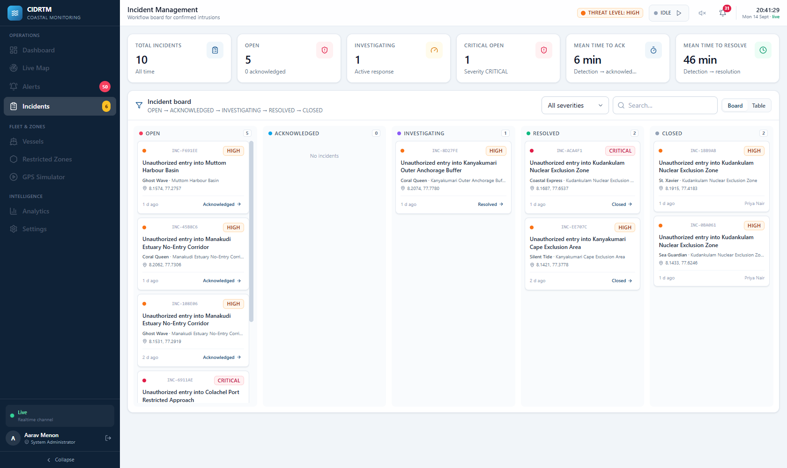
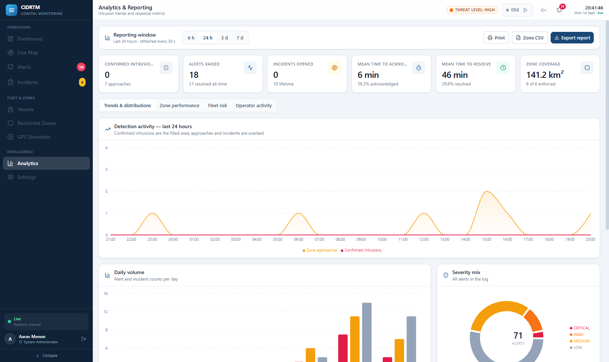

# CIDRTM — Coastal Intrusion Detection & Real-Time Monitoring System

A software-only maritime security platform that simulates a coastal surveillance
sector end to end: GPS telemetry in, geofence evaluation, intrusion detection,
real-time alerting, incident workflow, and a live Security Operations Centre
dashboard out.

**No hardware, no database, and no configuration are required to run it.** Clone,
install, start — the API boots with a seeded theatre, an in-memory persistence
driver, and a GPS simulator ready to go.

> **Design brief.** This is deliberately *not* a CRUD demo. It is architected as
> the software half of a final-year hardware + AI + IoT project, so a real GNSS
> node, a 4G uplink, a Raspberry Pi edge box, or a camera/AI detection service can
> be dropped in later **without rewriting the platform**. See
> [§10 Hardware extension path](#10-hardware-extension-path).

## Screenshots

Captured from the running dashboard against the live API.

| | |
|---|---|
|  |  |
| **Operations dashboard** — 8 KPIs, live map, alert and incident feeds | **Simulator running at 10×** — contacts moving, alerts streaming in |
|  |  |
| **Live monitoring map** — contact list, status tabs, layer controls | **Restricted zones** — polygons, area, live contact counts |
|  |  |
| **Incident board** — five-state workflow with legal-only transitions | **Analytics** — trends, distributions, MTTA/MTTR, exports |

---

## Table of contents

1. [What it does](#1-what-it-does)
2. [Quick start](#2-quick-start)
3. [Demo accounts](#3-demo-accounts)
4. [The dashboard](#4-the-dashboard)
5. [Architecture](#5-architecture)
6. [Geofencing & detection engine](#6-geofencing--detection-engine)
7. [Persistence: memory vs MongoDB](#7-persistence-memory-vs-mongodb)
8. [Real-time pipeline](#8-real-time-pipeline)
9. [API reference](#9-api-reference)
10. [Hardware extension path](#10-hardware-extension-path)
11. [Docker](#11-docker)
12. [Project structure](#12-project-structure)
13. [Configuration reference](#13-configuration-reference)
14. [Verification](#14-verification)
15. [Troubleshooting](#15-troubleshooting)

---

## 1. What it does

| Capability | Detail |
|---|---|
| **Live vessel tracking** | 20 seeded contacts moving across a Leaflet/OpenStreetMap theatre, rendered with status-coloured, heading-rotated markers. |
| **Restricted zone management** | Draw arbitrary polygons on the map; six zones are seeded. Per-zone severity, type, enable/disable, live area + contact counts. |
| **Geofencing engine** | Point-in-polygon + boundary-distance evaluation producing `OUTSIDE → APPROACHING → INSIDE` states and four verdicts. |
| **Intrusion detection** | Unauthorized entry raises a `CRITICAL` alert and auto-opens an incident case. |
| **Alerting** | 86 seeded + live alerts, five types, four severities, acknowledge/resolve workflow, audible two-tone alarm on new intrusions. |
| **Incident management** | `OPEN → ACKNOWLEDGED → INVESTIGATING → RESOLVED → CLOSED` with enforced legal transitions, assignment, MTTA/MTTR. |
| **GPS simulator** | Behaviour-driven vessels (patrol / transit / intruder / dark), 1×–10× time compression, start/pause/resume/step/reset. |
| **Analytics** | Hourly/daily trends, severity + type distributions, zone performance, fleet risk ranking, operator audit log, CSV/JSON export. |
| **RBAC** | `ADMIN` / `OPERATOR` / `ANALYST` with route-level and API-level enforcement. |

### Monitored area — the Kanyakumari coastal sector

The theatre is the southernmost stretch of the Tamil Nadu coast: the belt running
from **Thengapattanam** and **Colachel** on the Arabian Sea side, around
**Cape Comorin** at Kanyakumari, to **Kudankulam** on the Gulf of Mannar side
(≈ 8.00–8.23 °N, 77.20–77.78 °E). The cape is where the two sea fronts meet, and a
contact rounding it crosses from one to the other — so the bounds deliberately
span both.

All six seeded zones are anchored to real landings and installations, and each is
chosen to exercise a different enforcement posture:

| Zone | Type | Severity | What it exercises |
|---|---|---|---|
| **Kudankulam Nuclear Exclusion Zone** | Security | CRITICAL | A 1 000 m buffer around a high-value installation |
| **Manakudi Estuary No-Entry Corridor** | No-entry | CRITICAL | An environmentally protected estuary |
| **Kanyakumari Cape Exclusion Area** | No-entry | HIGH | The Vivekananda Rock / Thiruvalluvar statue cordon |
| **Colachel Port Restricted Approach** | Restricted | HIGH | Compulsory pilotage waters |
| **Muttom Harbour Basin** | Harbour | MEDIUM | A working fishing harbour |
| **Kanyakumari Outer Anchorage Buffer** | Custom | LOW | A purely advisory monitored anchorage |

The map also draws a **coastal boundary** — a deliberately coarse schematic trace
through the named landings, so operators get a land/sea reference. It is a
presentation aid, **not** survey-grade hydrography, and is labelled as such in the
UI.

---

## 2. Quick start

**Prerequisites:** Node.js ≥ 18.18. Nothing else — no MongoDB, no Docker, no API keys.

```bash
# 1. Install both packages
npm run install:all

# 2. Start the API (:4000) and the dashboard (:5173) together
npm run dev
```

Then open **http://localhost:5173** and sign in with a demo account below.

Prefer two terminals?

```bash
npm run dev:server   # terminal 1 → http://localhost:4000
npm run dev:client   # terminal 2 → http://localhost:5173
```

### Make it move

The simulator does **not** autostart, so the map is static on first load. Either:

- press **▶** in the top bar (simulator quick-start), or
- open **Simulation Console** → **Start**.

Then raise the speed to **5×** or **10×**. Within roughly a minute you will see
unauthorized contacts converge on a restricted zone, the intrusion alarm fire,
and an incident appear on the board.

---

## 3. Demo accounts

Seeded automatically on first boot. Passwords are bcrypt-hashed; there are no
plaintext credentials in the store.

| Role | Email | Password | Access |
|---|---|---|---|
| **ADMIN** | `admin@cidrtm.gov.in` | `Admin@123` | Everything, including users and destructive maintenance |
| **OPERATOR** | `operator@cidrtm.gov.in` | `Operator@123` | Zones, alerts, incidents, simulator — no user management |
| **ANALYST** | `analyst@cidrtm.gov.in` | `Analyst@123` | Read-only: dashboard, map, analytics |

The login page has one-click fill buttons for each.

> Change `JWT_SECRET` and the seeded passwords before any real deployment. The
> API refuses to delete the last remaining account, so you cannot lock yourself
> out through the UI.

---

## 4. The dashboard

| Page | What it gives you |
|---|---|
| **Login** | Split brand/form layout, Zod validation, show/hide password, remember-session, demo account shortcuts. |
| **Dashboard** | 8-KPI band, live map with threat-posture overlay, active alert feed, recent incidents, 24 h activity trend, severity donut, zone activity table, fleet composition, system status strip. |
| **Live Map** | Full-height Leaflet map: contact list with layer toggles, status tabs, search, tile-layer switch (street/terrain/satellite), fit-to-fleet, fullscreen, and the vessel detail panel. |
| **Vessels** | Registry table overlaid with **live** telemetry columns, filters, create/edit modal, detail drawer with mini route map, CSV export. |
| **Zones** | Zone cards with area/contact/intrusion counts, and a polygon editor: click to add vertices, drag to move, click a midpoint to insert, undo/clear/template. |
| **Alerts** | Filterable table with inline acknowledge/resolve, bulk acknowledge, CSV export, and an engine-metadata detail drawer. |
| **Incidents** | Kanban board across the five workflow states (or a table view), one-click legal transitions, assignment, and a case timeline. |
| **Simulation** | Transport controls, speed selector, manual position injection with a ready-made `curl` snippet, route table, and a pipeline explainer. |
| **Analytics** | Reporting windows (6 h/24 h/3 d/7 d), trends, distributions, zone performance, fleet risk, operator audit log, export. |
| **Settings** | Session info, notification preferences, system health, admin account directory, data maintenance. |

**Marker legend** — the four states the spec calls for:

| Marker | Meaning |
|---|---|
| 🟢 Green dart | **Authorized** contact, outside all zones |
| 🟡 Amber dart | **Approaching** — within the zone's approach buffer |
| 🔴 Red dart with pulse ring | **Intrusion** — inside a restricted zone unauthorized |
| ⚫ Grey dart | **Offline** — no telemetry within `VESSEL_OFFLINE_AFTER_MS` |
| ▲ Triangle glyph | **Unauthorized** registration (any state) |

---

## 5. Architecture

```
┌──────────────────────────── client (Vite + React 18 + TS) ────────────────────────────┐
│  Pages ── TanStack Query ── Axios ──┐                    ┌── Socket.IO client          │
│  Design-system UI kit (ui/)         │                    │   RealtimeProvider          │
│  Leaflet map + Recharts             │                    │   350 ms frame batching     │
└─────────────────────────────────────┼────────────────────┼─────────────────────────────┘
                                      │ REST /api/v1       │ websocket
┌─────────────────────────────────────▼────────────────────▼─────────────────────────────┐
│                            server (Express + TS + Socket.IO)                            │
│                                                                                        │
│  routes/ ── validators/ (Zod) ── middleware/ (auth · rbac · rate-limit · errors)        │
│      │                                                                                 │
│      ▼                                                                                 │
│  services/   ingestion ──▶ geofence ──▶ alert ──▶ incident ──▶ analytics                │
│      │                        │                    │                                    │
│      │                   (stateful episode cache)  │                                    │
│      ▼                        ▼                    ▼                                    │
│  repositories/  IDataStore  ──▶  MemoryStore  │  MongoStore                            │
│      ▲                                                                                 │
│      │                                                                                 │
│  services/simulation  ──  GPS Simulator (behaviour-driven, time-compressed)             │
│                                                                                        │
│  realtime/bus  ──▶  realtime/socket  ──▶  rooms: monitoring · alerts · incidents        │
└────────────────────────────────────────────────────────────────────────────────────────┘
```

### Three design decisions worth calling out

**1 — One repository interface, two drivers.**
Every service talks to `IDataStore`, never to Mongoose or a `Map`. `MemoryStore`
and `MongoStore` return documents of *identical shape*: string `_id`, ISO-string
timestamps. Switching drivers therefore changes zero API responses, which is why
the project runs with no database but upgrades to MongoDB by setting one variable.

**2 — Services never touch the socket.**
They emit through a transport-agnostic bus (`realtime/bus.ts`). Swapping
Socket.IO for MQTT, or adding a second transport for a mobile app, means editing
one file rather than a dozen services.

**3 — The simulator is a first-class engine, not a test fixture.**
It is a service with its own route surface, persisted state, and behaviour model,
because it is the component that gets *replaced* by real hardware later. Keeping
it honest now keeps the seam clean later.

---

## 6. Geofencing & detection engine

For every accepted position, the engine evaluates the vessel against every
enabled zone.

### Zone states

| State | Condition |
|---|---|
| `OUTSIDE` | Distance to the polygon boundary > the zone's approach buffer |
| `APPROACHING` | Outside the polygon, but within the approach buffer (default 500 m) |
| `INSIDE` | Point-in-polygon test passes |

Distance uses a local planar approximation against the nearest polygon *edge*,
which is accurate at coastal-sector scale and far cheaper than geodesic segment
distance. Inside the polygon the signed distance is negative.

### Verdicts

| Zone state | Authorization | Verdict | Result |
|---|---|---|---|
| `OUTSIDE` | any | `NORMAL` | nothing |
| `APPROACHING` | any | `WARNING` | `ZONE_APPROACH` alert at the zone's approach severity |
| `INSIDE` | authorized | `AUTHORIZED_ENTRY` | logged, no alert |
| `INSIDE` | unauthorized | `INTRUSION` | `UNAUTHORIZED_ENTRY` alert (`CRITICAL`) **+ auto-created incident** |

### Duplicate-alert suppression

This is the part that separates a working engine from a spam generator. A vessel
sitting inside a zone produces a position update every second — naively that is
3 600 alerts per hour.

The engine keeps a per-`(vessel, zone)` **episode** record holding the current
state, the last transition timestamp, a loiter tick counter, and a cooldown
deadline. Alerts fire on **state transitions**, not on every evaluation:

- entering `INSIDE` unauthorized → one `INTRUSION` alert, then the pair is
  silenced for `GEOFENCE_ALERT_COOLDOWN_MS` (default 45 s);
- after the cooldown, if the vessel is *still* intruding, a single reminder fires
  and the cooldown re-arms — so a persistent intruder keeps escalating without
  flooding;
- leaving the polygon resets the episode;
- loitering (`GEOFENCE_LOITER_TICKS` consecutive slow ticks inside a zone) raises
  a separate `SUSPICIOUS_MOVEMENT` alert.

The episode cache is explicitly invalidated when its inputs change — otherwise a
vessel edited from unauthorized to authorized would carry a stale `INTRUSION`
verdict forever:

- `forgetVessel(id)` — on authorization/identity change or deletion
- `forgetZone(id)` — on polygon/geometry edit, toggle, or deletion
- `reset()` — on a simulator reset

---

## 7. Persistence: memory vs MongoDB

**Driver selection is automatic.** If `MONGODB_URI` is set and reachable, the API
uses MongoDB. Otherwise — or if Mongo is unreachable — it falls back to the
in-memory driver and says so in the log. You never have to change application
code to switch.

```bash
# server/.env

# Zero-install demo mode (default)
MONGODB_URI=

# Real MongoDB
MONGODB_URI=mongodb://127.0.0.1:27017/cidrtm
MONGODB_DB=cidrtm
```

|  | MemoryStore | MongoStore |
|---|---|---|
| Setup | none | a running MongoDB |
| Storage | `Map` per collection | collections |
| Durability | JSON snapshot → `server/data/store.json`, debounced 2.5 s | full |
| Best for | demos, marking, CI, offline work | the report, a real deployment |
| Document shape | identical | identical |

`MEMORY_PERSIST=false` disables the snapshot if you want a guaranteed-clean
state on every boot. `npm run seed:reset` wipes and re-seeds either driver.

Both drivers store the zone polygon twice: as the authoring-friendly
`coordinates: [{lat, lng}]` array **and** as a derived GeoJSON `Polygon`. The
array is what the editor round-trips; the GeoJSON field is what a future
`$geoWithin` / `2dsphere` query would use — so adding spatial indexing later is a
schema-free change.

---

## 8. Real-time pipeline

```
 GPS Simulator ──▶ POST /api/v1/telemetry ──▶ Ingestion Service
                                                    │
                                            Geofencing Engine
                                                    │
                                          Intrusion Detection
                                                    │
                                              Socket.IO bus
                                                    │
                                    ┌───────────────┴───────────────┐
                              Dashboard state                  Alert + Incident
                              (no page refresh)                (persisted + broadcast)
```

### Events

| Event | Payload |
|---|---|
| `vessel:location_updated` | Full location broadcast: position, speed, heading, nearest zone, zone state, verdict |
| `vessel:status_changed` | Vessel id + new status |
| `intrusion:detected` | The geofence event with vessel, zone, distance, severity |
| `alert:created` / `alert:acknowledged` / `alert:resolved` | Alert document |
| `incident:created` / `incident:updated` | Incident document |
| `simulation:tick` / `simulation:state` | Simulator progress and control state |
| `stats:updated` | Aggregate KPIs, every 5 s |
| `snapshot` | Full state on connect, so a fresh tab is never empty |

Socket.IO connections authenticate with the JWT during the handshake — an
unauthenticated client is rejected before it can join a room. Rooms are
`monitoring`, `alerts`, and `incidents`; clients join automatically and can
subscribe/unsubscribe for finer control.

### Two performance decisions

**Frame batching.** 20 vessels at 1 Hz is 20 socket frames per second, and each
one would re-render the whole React tree. Position frames are buffered into a
`useRef` map and flushed into state on a 350 ms interval, so the map animates
smoothly at roughly 3 renders/second regardless of fleet size.

**Time compression, not tick compression.** The 1×/2×/5×/10× multiplier scales
*simulated seconds per tick*, not the tick rate. Bandwidth and render cost stay
constant at every speed — only the distance each vessel covers grows. This is why
10× looks fast without stuttering.

---

## 9. API reference

Base path `/api/v1`. All responses use the envelope
`{ success, data, meta? }` or `{ success: false, error: { code, message, details? } }`.

### Auth

| Method | Endpoint | Role | Purpose |
|---|---|---|---|
| `POST` | `/auth/login` | — | Obtain a JWT (tight rate limit) |
| `GET` | `/auth/me` | any | Revalidate the current session |
| `POST` | `/auth/logout` | any | Audit-logged logout |
| `GET/POST/PATCH/DELETE` | `/users` | ADMIN | Account management |

### Vessels, zones, alerts, incidents

| Method | Endpoint | Role |
|---|---|---|
| `GET` | `/vessels` · `/vessels/summary` · `/vessels/:vesselId` · `/vessels/:vesselId/track` · `/vessels/:vesselId/stats` | any |
| `POST` / `PATCH` | `/vessels` · `/vessels/:vesselId` | OPERATOR |
| `DELETE` | `/vessels/:vesselId` | ADMIN |
| `GET` | `/zones` · `/zones/activity` · `/zones/:zoneId` | any |
| `POST` / `PATCH` | `/zones` · `/zones/:zoneId` | OPERATOR |
| `POST` | `/zones/:zoneId/toggle` | OPERATOR |
| `DELETE` | `/zones/:zoneId` | OPERATOR |
| `GET` | `/alerts` · `/alerts/summary` · `/alerts/:alertId` | any |
| `POST` | `/alerts/:alertId/acknowledge` · `/alerts/:alertId/resolve` | OPERATOR |
| `GET` | `/incidents` · `/incidents/summary` · `/incidents/:incidentId` | any |
| `PATCH` | `/incidents/:incidentId/status` · `/incidents/:incidentId/assign` | OPERATOR |

### Telemetry — the ingestion seam

| Method | Endpoint | Auth | Purpose |
|---|---|---|---|
| `POST` | `/telemetry` | user JWT **or** `x-device-key` | Ingest one position (202) |
| `POST` | `/telemetry/batch` | same | Ingest a backlog |
| `GET` | `/telemetry/latest` | any | Latest position per vessel |
| `GET` | `/telemetry/tracks/:vesselId` | any | Track history |

```bash
curl -X POST http://localhost:4000/api/v1/telemetry \
  -H "Content-Type: application/json" \
  -H "x-device-key: $DEVICE_API_KEY" \
  -d '{
    "vesselId": "VSL-4F2A91",
    "latitude": 8.078,
    "longitude": 77.536,
    "speed": 12.4,
    "direction": 137,
    "source": "GNSS"
  }'
```

Those coordinates sit inside the **Kanyakumari Cape Exclusion Area**, so the call
returns a `202` whose payload carries `verdict: "INTRUSION"` and a freshly raised
`CRITICAL` alert — a one-command demonstration of the whole detection pipeline.

### Simulator & analytics

| Method | Endpoint | Role |
|---|---|---|
| `GET` | `/simulation/state` | any |
| `POST` | `/simulation/start` · `/pause` · `/resume` · `/stop` · `/step` · `/speed` · `/reset` | ADMIN/OPERATOR |
| `GET` | `/analytics/overview` · `/full` · `/hourly` · `/daily` · `/summary` · `/zones` · `/audit` | any |
| `GET` | `/health` | — |

---

## 10. Hardware extension path

The mini project is software-only, but every seam a hardware build needs already
exists.

**Real GNSS instead of the simulator.** Point a Raspberry Pi (or any GNSS module)
at `POST /api/v1/telemetry` with the `x-device-key` header — the exact payload is
in the `curl` example above and is echoed in the Simulation Console's *Manual
position injection* panel. The simulator and real hardware speak the *same*
contract, so the dashboard cannot tell them apart and needs no changes. Nothing
else in the platform moves.

**Edge AI.** A camera/object-detection service running on the Pi can post
detections through the same authenticated seam and raise `SUSPICIOUS_MOVEMENT`
alerts. The alert and incident models already carry the fields such a service
would populate.

**Spatial queries at scale.** Zone polygons are already persisted as GeoJSON
alongside their authoring array, so adding a `2dsphere` index and a `$geoWithin`
pre-filter is additive.

**Transport swap.** Because services emit through `realtime/bus.ts`, an MQTT or
WebSocket-gateway transport for constrained devices is a new bus implementation,
not a refactor.

The guiding rule: **the simulator is a peer of the hardware, never a mock inside
the application logic.** That is what makes the swap cheap.

---

## 11. Docker

> **Not yet exercised.** The Dockerfiles and compose file are written and
> reviewed, but Docker was not available in the environment where this project
> was built, so `docker compose up --build` has **not** been run. Treat the
> container path as untested and allow for a first-run fix. The non-Docker
> workflow above is the one that has been verified end to end.

```bash
docker compose up --build      # → dashboard on http://localhost:8080
```

The stack ships without MongoDB (the API uses its in-memory driver, snapshotted
into a named volume). To run against the bundled Mongo service, set
`MONGODB_URI: "mongodb://mongo:27017/cidrtm"` in `docker-compose.yml` and start it
with the profile:

```bash
docker compose --profile mongo up --build
```

nginx serves the built dashboard and reverse-proxies `/api` and `/socket.io`
(including the websocket upgrade) to the API container, so the whole thing is
same-origin and needs no CORS configuration.

---

## 12. Project structure

```
cidrtm/
├── package.json                 # root orchestrator: install:all · dev · lint · build · seed
├── docker-compose.yml
├── .prettierrc.json             # shared formatter config
├── scripts/dev.mjs              # zero-dependency dual-process launcher
├── docs/
│   ├── screenshots/             # captures used in this README
│   └── postman/                 # CIDRTM.postman_collection.json (54 requests)
│
├── server/
│   ├── .env.example
│   ├── .eslintrc.cjs
│   ├── Dockerfile
│   └── src/
│       ├── index.ts             # bootstrap: store → seed → app → realtime → listen
│       ├── app.ts               # express wiring, helmet, CORS, rate limits
│       ├── seed.ts / seed-data.ts
│       ├── config/              # env · constants (THEATRE, COASTLINE) · logger
│       ├── types/domain.ts      # single source of truth for all enums + docs
│       ├── utils/               # geo · ids · http
│       ├── repositories/        # IDataStore · memory · mongo · index (driver pick)
│       ├── models/              # mongoose schemas
│       ├── services/            # auth · vessel · zone · geofence · ingestion
│       │                        # alert · incident · simulation · analytics · audit
│       ├── middleware/          # auth · rbac · validate · rateLimit · error · log
│       ├── validators/          # Zod schemas
│       ├── routes/              # one router per resource + index
│       └── realtime/            # bus (transport-agnostic) · socket (Socket.IO)
│
└── client/
    ├── Dockerfile / nginx.conf
    ├── tailwind.config.js
    └── src/
        ├── main.tsx / App.tsx   # providers + route table + role gates
        ├── types/               # mirror of the server domain types
        ├── lib/                 # api (axios+envelope) · socket · constants · format
        ├── store/               # auth · realtime (frame batching) · toast
        ├── components/
        │   ├── ui/              # design-system kit: base · form · overlay · table
        │   ├── map/             # LiveMap · vesselIcon · MapLegend · detail panel
        │   ├── layout/          # Sidebar · Topbar · AppLayout · IntrusionAlarm
        │   └── charts/          # Recharts trend + distribution components
        └── pages/               # 10 routed pages
```

**~80 TypeScript modules**, `tsc --noEmit` clean on both packages, production
build verified.

---

## 13. Configuration reference

All variables are optional — every one has a working default. See
`server/.env.example`.

| Variable | Default | Notes |
|---|---|---|
| `PORT` | `4000` | API port |
| `CLIENT_ORIGIN` | `http://localhost:5173` | CORS allow-list (comma-separated) |
| `JWT_SECRET` | dev value | **Change in production** |
| `JWT_EXPIRES_IN` | `12h` | Token lifetime |
| `DEVICE_API_KEY` | dev value | Shared secret for `x-device-key` telemetry |
| `MONGODB_URI` | *(empty)* | Empty ⇒ in-memory driver |
| `MEMORY_PERSIST` | `true` | Snapshot the memory store to disk |
| `GEOFENCE_APPROACH_BUFFER_M` | `500` | Approach ring width |
| `GEOFENCE_ALERT_COOLDOWN_MS` | `45000` | Duplicate-alert suppression window |
| `GEOFENCE_LOITER_TICKS` | `6` | Slow ticks before a loiter alert |
| `VESSEL_OFFLINE_AFTER_MS` | `45000` | Silence before a vessel is `OFFLINE` |
| `TRACK_POINTS_PER_VESSEL` | `600` | Ring buffer size for route history |
| `SIM_TICK_MS` | `1000` | Simulator tick period |
| `SIM_SPEED_MULTIPLIER` | `1` | Boot-time speed (1/2/5/10) |
| `SIM_AUTOSTART` | `false` | Start moving on boot |

---

## 14. Verification

What was checked, and how to re-check it yourself.

### Static checks

```bash
npm run typecheck     # tsc --noEmit on both packages — clean
npm run lint          # ESLint on both packages — 0 errors
npm run format:check  # Prettier
npm run build         # server tsc + client vite build — succeeds
```

The client production build transforms 2 549 modules into ~1.2 MB of JS
(≈290 kB gzipped) split across `react`, `maps`, `charts`, `query` and `index`
chunks.

Lint leaves four advisory `react-refresh/only-export-components` warnings. Those
are the React context modules (`auth`, `realtime`, `toast`) and the icon registry,
which pair a provider with a `useX()` hook in one file — the conventional pattern.
Splitting them would buy nothing but churn, so they are intentionally left as
warnings rather than silenced.

### Postman

`docs/postman/CIDRTM.postman_collection.json` — 54 requests across 10 folders.

Import it, then run **Auth → Login (admin)** first: its test script writes the JWT
into the `token` collection variable, so every other request is authenticated
automatically. The collection also includes negative tests that assert the failure
contract — a hostile `Origin` must return **403**, a bad body must return **422**
with per-field `details`, and an illegal incident transition must return **409**.

### Runtime pipeline check

Start the stack, log in, then press **▶** in the top bar (or set 10× in the
Simulation Console). Vessels should move immediately and the alert counters
should climb **without a page refresh**.

Measured over a 25-second window at 10× with the browser open on the dashboard:

| Metric | Before | After |
|---|---|---|
| Active alerts | 72 | **75** |
| Intrusions today | 12 | **13** |
| Vessels under intrusion | 3 | **4** |
| Open incidents | 12 | **13** |
| Offline vessels | 0 | **1** |

Every vessel marker's screen position changed between samples, confirming
continuous movement rather than a static render.

### API check

```bash
# health
curl -s http://localhost:4000/api/v1/health

# login and reuse the token
TOKEN=$(curl -s -X POST http://localhost:4000/api/v1/auth/login \
  -H 'Content-Type: application/json' \
  -d '{"email":"admin@cidrtm.gov.in","password":"Admin@123"}' \
  | node -pe 'JSON.parse(require("fs").readFileSync(0)).data.token')

curl -s http://localhost:4000/api/v1/analytics/overview -H "Authorization: Bearer $TOKEN"
curl -s http://localhost:4000/api/v1/simulation/state   -H "Authorization: Bearer $TOKEN"
```

### Security checks

```bash
# A hostile origin is refused with 403, not 500.
curl -o /dev/null -w '%{http_code}\n' -X POST http://localhost:4000/api/v1/auth/login \
  -H 'Content-Type: application/json' -H 'Origin: http://evil.example.com' \
  -d '{"email":"admin@cidrtm.gov.in","password":"Admin@123"}'
# → 403

# Protected routes reject anonymous callers.
curl -o /dev/null -w '%{http_code}\n' http://localhost:4000/api/v1/vessels
# → 401
```

---

## 15. Troubleshooting

| Symptom | Cause / fix |
|---|---|
| `Missing dependencies in server/` | Run `npm run install:all` from the repo root. |
| Port already in use | Change `PORT` in `server/.env`, or `npx vite --port 5174`. |
| CORS error after switching to `127.0.0.1` | Already handled — any loopback origin is expanded to its `localhost` / `127.0.0.1` / `[::1]` equivalents. A rejected origin returns **403**, never a 500. |
| Map tiles are blank | The tile server needs internet access. Zones and vessels still render — only the basemap is missing. |
| Map markers are invisible | Fixed by using inline-SVG `divIcon` markers; if you see broken-image icons you are on an older build — rebuild the client. |
| Vessels never move | The simulator does not autostart. Press ▶ in the top bar, or set `SIM_AUTOSTART=true`. |
| Log says `driver: memory` but you wanted Mongo | MongoDB was unreachable, so the API fell back deliberately. Check `MONGODB_URI` and that mongod is running. |
| Alerts appear in bursts | Expected at high simulator speeds — the cooldown is per `(vessel, zone)` and measured in real time, not simulated time. |
| Server hangs and stops answering | Do not launch it piped into `head`/`tail`; once that reader exits, the closed stdout pipe blocks the process. Run `npm run dev:server` instead. |
| Vite refuses to start after installing a package | It wants to re-optimise deps and its cache clear tripped a bulk-delete guard (`SAFE_DELETE_BULK_CONFIRM_REQUIRED`). The cache is regenerable — clear it and restart: `rm -rf client/node_modules/.vite`. |
| Want a clean slate | `npm run seed:reset`, or delete `server/data/store.json`. |

---

**Stack:** React 18 · Vite · TypeScript · Tailwind · React Router · TanStack Query
· Axios · Leaflet / React-Leaflet · Socket.IO · Recharts · React Hook Form + Zod ·
Lucide · Node · Express · MongoDB/Mongoose · JWT · bcrypt · Helmet · Winston ·
Docker · nginx · ESLint · Prettier · Postman.
